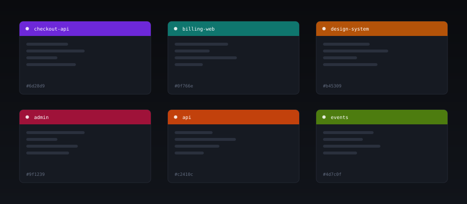

# hue-shift

**Peacock colors one workspace. hue-shift colors all of them.**

Give every VS Code project its own window colour from the terminal. No extension, no config file to hand-edit, no dependencies.

```bash
npx hue-shift --random
```



---

## Why not Peacock?

Peacock is great. It is also an extension, so it can only colour the workspace you are currently looking at. If you have 75 projects and want each one to look different, that is 75 manual actions.

`hue-shift` is a CLI. It walks your projects folder and writes the same `workbench.colorCustomizations` keys Peacock uses — so the two are compatible — but it does every project in one pass.

| | Peacock | Project Colors | Multi-Workspace | **hue-shift** |
|---|---|---|---|---|
| Runs from the terminal | ✗ | ✗ | ✗ | **✓** |
| `npx`, nothing to install | ✗ | ✗ | ✗ | **✓** |
| Colour all projects at once | ✗ | ✗ | ✗ | **✓** |
| Detect drift (`--check`) | ✗ | ✗ | ✗ | **✓** |
| Contrast validation | ✗ | ✗ | ✗ | **✓** |
| Colour + theme + icons | ✗ | ✗ | theme only | **✓** |
| Zero runtime dependencies | ✗ | ✗ | ✗ | **✓** |
| Works on macOS, Linux, Windows | ✓ | ✓ | ✓ | **✓** |

Measured: 75 projects in **0.4 s**. No build step, no daemon, no extension host.

---

## Install

Nothing to install — run it directly:

```bash
npx hue-shift --random
```

Or install it:

```bash
npm i -g hue-shift          # global
npm i -D hue-shift          # per project, for npm scripts
bunx hue-shift --random     # bun
pnpm dlx hue-shift --random # pnpm
```

Requires Node 18 or newer.

---

## Quick start

Colour the project you are standing in:

```bash
cd ~/code/my-app
npx hue-shift --random
```

Colour every project under a folder, reproducibly:

```bash
npx hue-shift --root ~/Documents/projects --random --seed 42
```

See what it would do before it does it:

```bash
npx hue-shift --root ~/Documents/projects --random --seed 42 --dry
```

Pick a specific colour and only colour the title bar:

```bash
npx hue-shift . --color amber --parts title
```

Colour plus a full theme and icon set:

```bash
npx hue-shift . --color teal --theme "Default Dark Modern" --icons Seti
```

Reload the window (`Cmd+Shift+P` → `Developer: Reload Window`) and the colour appears.

---

## Commands

```
hue-shift [project] [options]        one project (default: current directory)
hue-shift --root <dir> [options]     every subfolder of <dir> as a project
```

### Colour

| Flag | What it does |
|---|---|
| `--random` | random colour per project |
| `--seed <n>` | make `--random` reproducible |
| `--color <hex\|name>` | a specific colour |
| `--list-colors` | print the built-in palette |

### Appearance

| Flag | What it does |
|---|---|
| `--parts <list>` | `title,activity,status,border,tab,sash,sidebar` · default `title,activity,status` |
| `--adjust <part=mode>` | `lighten` or `darken` per part, e.g. `title=lighten,status=darken` |
| `--adjust-pct <n>` | how far to shift, default `6` |
| `--exclude <key>` | never write this colour key (repeatable) |
| `--theme <name>` | also set `workbench.colorTheme` |
| `--icons <name>` | also set `workbench.iconTheme` |

### Checks

| Flag | What it does |
|---|---|
| `--check` | report drift; writes nothing |
| `--reset` | remove every colour key hue-shift wrote |
| `--dry` | print the plan; writes nothing |
| `--json` | machine-readable output |

Exit codes: `0` success, `1` usage error, `2` a project failed.

---

## Named palette

```
amber              #b45309     magenta            #a21caf
angular-red        #dd0531     mandalorian-blue   #1857a4
azure-blue         #007fff     node-green         #215732
burnt-orange       #c2410c     olive              #4d7c0f
crimson            #9f1239     peacock-blue       #0f4c81
cyan               #0e7490     react-blue         #61dafb
green              #15803d     rose               #be123c
javascript-yellow  #f9e64f     slate              #334155
                               svelte-orange      #ff3d00
                               teal               #0f766e
                               violet             #6d28d9
                               vue-green          #42b883
```

Every generated colour is checked against its foreground, so text on the title bar never drops below 4.5:1 contrast.

---

## Config file

Pinned colours while you are away from the keyboard. `hue-shift` reads two files and merges them, project winning over global. CLI flags win over both.

`~/.hue-shift.json` — defaults for every project:

```json
{
  "parts": ["title", "activity", "status"],
  "adjust": { "activity": "lighten" },
  "adjustPct": 6,
  "theme": "Default Dark Modern",
  "icons": "Seti"
}
```

`<project>/.hue-shift.json` — this project only:

```json
{
  "color": "teal",
  "parts": ["title"],
  "exclude": ["statusBar.background"]
}
```

Fields: `color`, `random`, `seed`, `parts`, `adjust`, `adjustPct`, `exclude`, `theme`, `icons`.

---

## What it writes

Only this block, and only the keys for the parts you asked for:

```json
{
  "workbench.colorCustomizations": {
    "titleBar.activeBackground": "#b45309",
    "titleBar.activeForeground": "#ffffff",
    "titleBar.inactiveBackground": "#b45309cc",
    "titleBar.inactiveForeground": "#ffffff99",
    "activityBar.background": "#b45309",
    "activityBar.foreground": "#ffffff",
    "activityBar.inactiveForeground": "#ffffff88",
    "activityBar.activeBackground": "#b45309",
    "statusBar.background": "#b45309",
    "statusBar.foreground": "#ffffff",
    "statusBar.debuggingBackground": "#b45309",
    "statusBar.noFolderBackground": "#b45309"
  }
}
```

Your `settings.json` is treated carefully:

- **Merged, not replaced.** Colour keys hue-shift does not own are preserved.
- **Comments survive.** JSONC `//` and `/* */` outside the colour block are untouched.
- **BOM and CRLF survive.** Windows line endings stay Windows line endings.
- **Peacock stays in sync.** If `peacock.color` exists, it is updated to match.
- **`--reset` is exact.** It removes only the keys listed above and leaves everything else.

---

## What it can't do

Honest limits, because a CLI is not an extension:

- **No status-bar colour chip.** That needs the extension host.
- **No Live Share host/guest colours.** Needs the VS Code API at runtime.
- **No "surprise me on startup".** A CLI only runs when you run it.
- **No in-editor command palette entries.** Use your terminal.

If you want those, run Peacock alongside. They write the same keys, so they do not fight.

---

## Real workflow

Colours that stay put, with drift detection in CI:

```bash
# once, pin a palette
cd ~/Documents/projects
npx hue-shift --root . --random --seed 42

# later, after a merge or a settings sync
npx hue-shift --root . --random --seed 42 --check
```

`--check` exits non-zero when a project has drifted, so it works as a pre-commit or CI guard.

---

## Examples

`examples/` contains runnable scripts:

| File | Shows |
|---|---|
| [`basic.sh`](examples/basic.sh) | one project, one colour |
| [`bulk-seeded.sh`](examples/bulk-seeded.sh) | all projects, reproducible |
| [`monorepo.sh`](examples/monorepo.sh) | nested packages with a shared palette |
| [`ci-drift.sh`](examples/ci-drift.sh) | fail a build when colours drift |
| [`config-file/`](examples/config-file/) | a pinned `.hue-shift.json` |

---

## Development

```bash
git clone https://github.com/aotr/hue-shift.git
cd hue-shift
npm test
```

No dependencies to install. Tests use the built-in `node:test` runner.

```
src/colors.js     colour maths, palette, seeded random
src/settings.js   JSONC-safe read / merge / write / reset / check
src/cli.js        argument parsing and the runner
bin/hue-shift.js  entry point
```

83 tests covering hex parsing, HSL round trips, contrast, JSONC edge cases, BOM/CRLF preservation, merging, reset idempotence and every CLI flag.

---

## License

MIT
